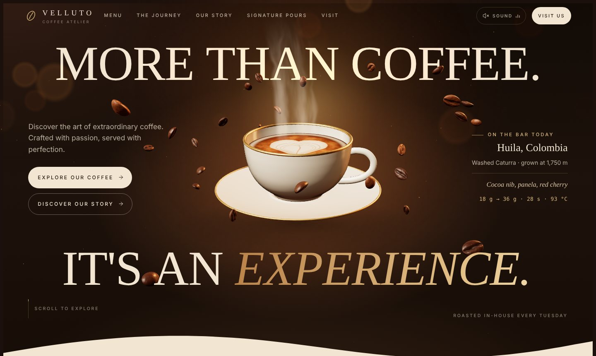
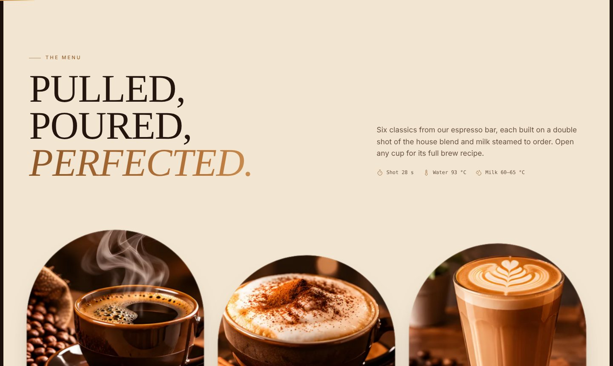
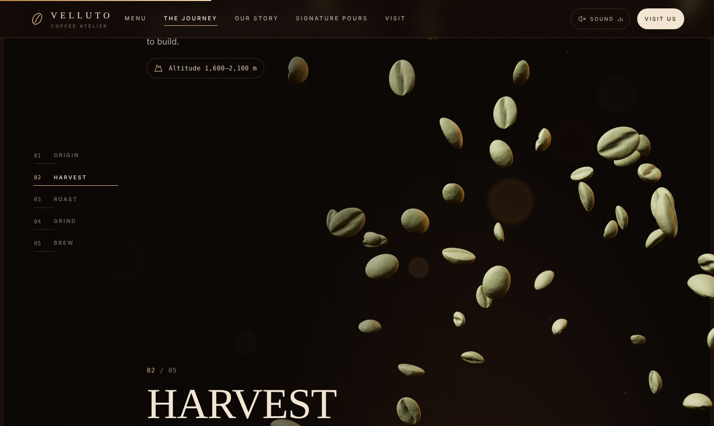
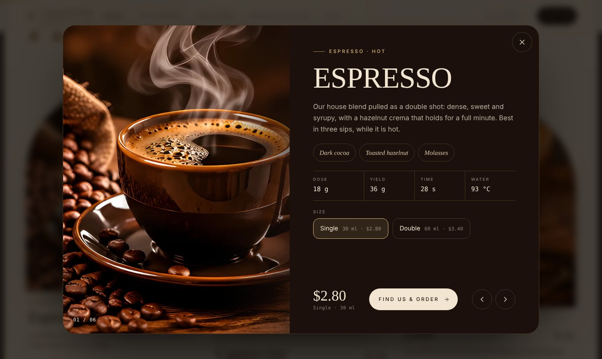
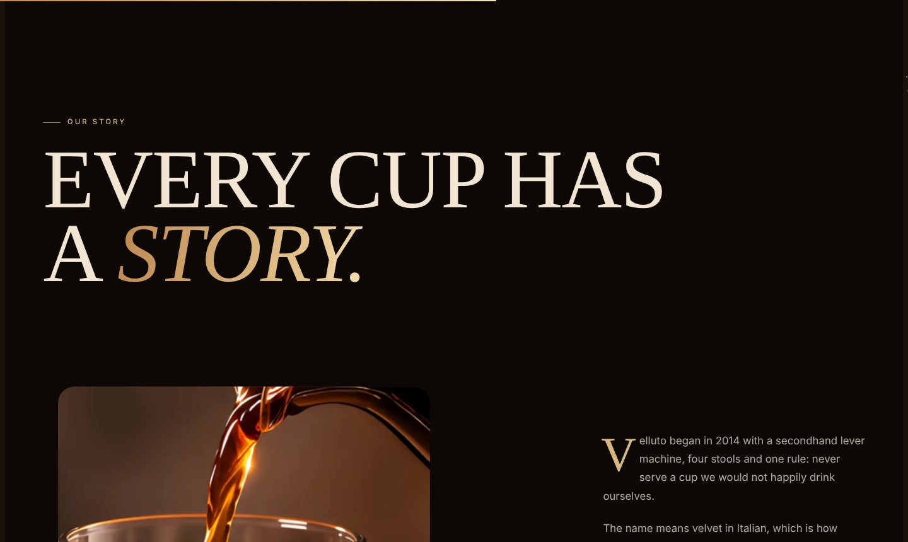
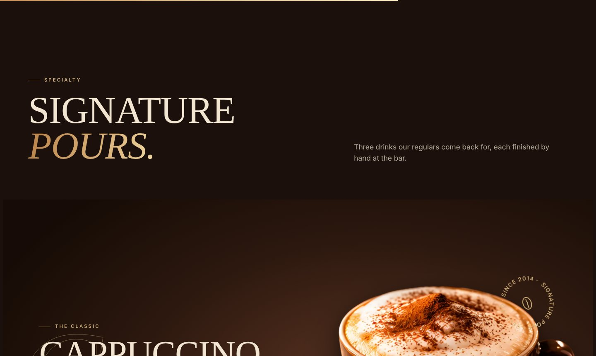
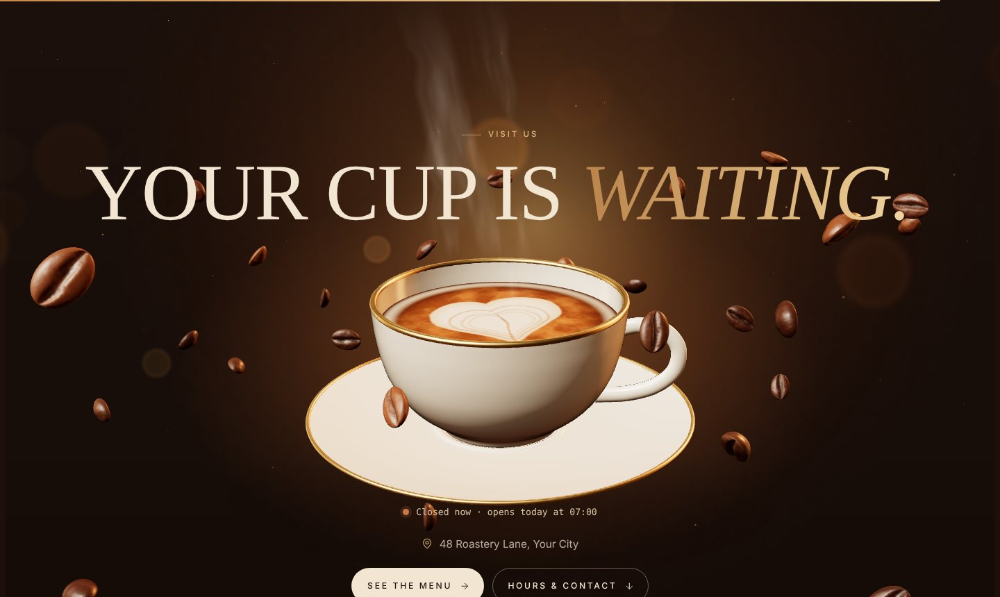
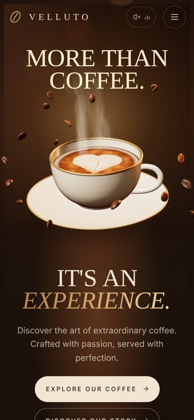

<div align="center">

<a href="https://iamruqia.github.io/velluto-coffee/"></a>

# Velluto · Coffee Atelier

### A cinematic, scroll-driven 3D website for a specialty coffee shop.

A live 3D cup, steam you can push around with your cursor, and a scroll journey that follows one coffee bean from the farm all the way into your cup.

[](https://iamruqia.github.io/velluto-coffee/)
[](https://threejs.org)
[](https://gsap.com)
[](#-run-it-locally)
[](LICENSE)

**[☕ Open the live site](https://iamruqia.github.io/velluto-coffee/)**

</div>

---

## ✨ The idea

Most café websites are a photo, a menu and a map. Velluto tries to make you **smell the coffee** through the screen.

The page opens like an espresso shot being pulled. A porcelain cup floats in warm studio light, steam curls up through the headline, and coffee beans orbit around it. As you scroll, the beans leave the cup and take you on a journey: from a green seed on a mountainside, through harvest and roasting, into the grinder and finally back into a fresh cup.

> **Velluto** means *velvet* in Italian, after the texture of perfectly steamed milk. The brand, prices, address and opening hours are a design concept, ready to be swapped for a real café's details.

---

## 🖼️ A walk through the site

<table>
<tr>
<td width="50%"></td>
<td width="50%"></td>
</tr>
<tr>
<td><b>The menu.</b> Cream pours over the dark like milk into espresso, and six drinks rise up in arched frames. Each card tilts in 3D with a moving glare as you hover over it.</td>
<td><b>From bean to cup.</b> A pinned, scroll-driven 3D journey in five chapters: <i>Origin, Harvest, Roast, Grind, Brew</i>. The camera flies through a cloud of beans that turn from green to roasted brown, burst into grounds and spiral down into the cup.</td>
</tr>
<tr>
<td></td>
<td></td>
</tr>
<tr>
<td><b>Drink details.</b> Clicking a drink opens its full recipe: dose, yield, time, water temperature and tasting notes. You can switch sizes and the price updates. Arrow buttons move between drinks.</td>
<td><b>The story.</b> Photos open from a slight crop while the images drift inside their frames, with editorial typography and a drop cap.</td>
</tr>
<tr>
<td></td>
<td></td>
</tr>
<tr>
<td><b>Signature pours.</b> On desktop, vertical scrolling turns into a horizontal reel of the house favorites.</td>
<td><b>Your cup is waiting.</b> The 3D cup returns for the finale. A live <i>open now / closed</i> line is worked out from the visitor's own clock, and today's row in the opening hours is highlighted.</td>
</tr>
</table>

<div align="center">

<br><sub>Fully responsive, with a lighter 3D scene on phones.</sub>
</div>

---

## 🛠️ How it's built

The site is plain **HTML, CSS and JavaScript**, with no framework and no build step. Three small, focused libraries do the heavy lifting, loaded from public CDNs:

| Library | Used for |
|---|---|
| [**Three.js** r158](https://threejs.org) | The real-time 3D scene: cup, steam, beans and particles |
| [**GSAP** + ScrollTrigger](https://gsap.com) | Scroll choreography and pinned sections |
| [**Lenis**](https://lenis.darkroom.engineering) | Smooth, weighted scrolling |

### ☕ A 3D cup made entirely in code

There is no 3D model file. Everything in [`js/scene.js`](js/scene.js) is generated when the page loads:

- **The porcelain cup and saucer** are "turned on a lathe": a 2D side profile is spun around an axis (`LatheGeometry`), just like a real potter's wheel. They get a gold rim and glossy glaze.
- **The latte art** is a custom GPU shader (`ShaderMaterial`) that draws an animated heart in the coffee's surface, with crema that slowly swirls.
- **The steam** is another shader, driven by a noise texture generated in code. It drifts with the cursor: the faster you move the mouse, the stronger the "wind".
- **Every coffee bean** is an ellipsoid with a flat face and an S-shaped crease. Hundreds of them are drawn in a single pass with `InstancedMesh`, so they stay fast.
- **The lighting** is a soft studio environment baked once at start-up (PMREM), with filmic tone mapping (ACES) and soft shadows. The light changes along the journey, from cool daylight at the farm to the roaster's flame to a warm café glow.
- **Dust motes and bokeh** float through the light for depth.

The scene exposes a small, documented API (`init`, `bind`, `pointer`, `intro`, `tick`…) so the interface code in [`js/app.js`](js/app.js) can drive it without knowing its internals.

### 🎬 Choreography that never blocks reading

- **Transform-only animation.** Every scroll effect moves things with transforms and opacity, which keeps the browser fast. All content is fully readable when nothing is moving.
- **One shared clock.** Lenis, GSAP and the 3D scene all run on a single ticker, so scrolling, animation and rendering stay perfectly in sync with no jitter.
- **A real loader.** The opening animation is an espresso shot filling while the fonts and 3D scene warm up, with a live extraction timer (*18 g → 36 g*). Shaders are compiled up front, so the first frame doesn't stutter.
- **A smart nav.** It turns to glass after the hero, hides as you scroll down, comes back as you scroll up, and switches to a cream style over light sections.

### 🛡️ Built to never break

Every feature degrades gracefully:

- **No WebGL?** The 3D scene is replaced by photographs, and the page looks complete.
- **GSAP fails to load?** The content shows as a clean static page.
- **Reduce motion turned on?** Smoothing, parallax and the 3D animation are switched off (`prefers-reduced-motion`).
- **Slower device or phone?** A low-power mode lowers the render resolution and turns off shadows.
- **GPU resets?** The page notices that the 3D context was lost and falls back to photos instead of showing a blank canvas.
- **Storage blocked (private browsing)?** Saving the sound setting fails quietly.

### ♿ Accessible and search-friendly

- A **skip to content** link, meaningful `aria` labels throughout, and native `<dialog>` elements for the mobile menu and drink details, which handle focus and the Escape key.
- The animated hero letters are hidden from screen readers, which read the real headline instead.
- The custom cursor only appears on devices with a mouse, never on touch screens.
- **Responsive images:** every photo comes in two sizes in modern WebP format (`srcset`), loads lazily, and fades in once decoded, keeping a blurred preview if a download fails.
- **Structured data:** the café, its menu, prices and opening hours are described with [schema.org](https://schema.org) `CafeOrCoffeeShop` markup, so search engines can show them directly.
- **Open Graph tags** make links look good when shared.

### 🔊 Little details

- An optional porcelain *tink* on hover, synthesized live with the Web Audio API. It's off by default, and the choice is remembered.
- One-click **copy buttons** for the phone number and email.
- A **newsletter form** with validation and a friendly confirmation message.

---

## 📁 Project structure

```
velluto-coffee/
├── index.html            # All page content, structured data and the menu data
├── css/
│   └── main.css          # Design system: type, color, layout, motion, states
├── js/
│   ├── scene.js          # The Three.js scene (cup, steam, beans, journey)
│   └── app.js            # Interface: scroll choreography, menu, dialogs, hours…
├── img/                  # Drink and bean photos, each in two WebP sizes
├── docs/screenshots/     # Images used in this README
├── scripts/check.mjs     # Quality checks, run in CI
└── .github/workflows/    # Runs the checks on every push
```

Both JavaScript files are organized into clearly labelled sections and run in strict mode inside their own scope, so nothing leaks into the global page.

---

## 🚀 Run it locally

You only need [Node.js](https://nodejs.org) 18 or newer, or any static web server.

```bash
git clone https://github.com/iamRuqia/velluto-coffee.git
cd velluto-coffee
npm start          # serves the site at http://localhost:8080
npm run check      # runs the same checks as CI
```

Prefer Python? `python3 -m http.server 8080` works too.

### ✅ Automatic checks

[`scripts/check.mjs`](scripts/check.mjs) runs on every push. It has no dependencies, and it confirms that:

- every script compiles,
- the menu data and structured data are valid JSON,
- every image, script and stylesheet the page points to exists,
- the page has its language, viewport, title and description.

---

## 🎨 Make it your café

Everything a café owner would change is in plain sight:

| To change… | Edit |
|---|---|
| Drinks, descriptions, recipes, sizes and prices | The `products-data` JSON block in `index.html` |
| Address, phone, email and opening hours | The *Visit* section and the `application/ld+json` block in `index.html` |
| Colors, fonts and spacing | The design tokens at the top of `css/main.css` |
| Photos | Replace the files in `img/`, keeping the same names (one large and one small version of each) |
| Newsletter sign-up | The marked spot in the footer section of `js/app.js`, where your email provider connects (Mailchimp, Buttondown, ConvertKit…) |

---

## 🌍 Deploy

The project is just static files, so it runs on any host:

- **GitHub Pages:** already live at [iamruqia.github.io/velluto-coffee](https://iamruqia.github.io/velluto-coffee/), and it updates automatically on every push to `main`.
- **Any web host (cPanel, DirectAdmin, FTP):** upload the files into `public_html` or a sub-folder.
- **Netlify, Vercel or Cloudflare Pages:** import the repo, leave the build command empty and set the output folder to `/`.

---

## 👩‍💻 Author

**Ruqia Enayat**, UI/UX & Product Designer and founder of [TICK Group](https://tick.company)<br>
[Portfolio](https://tick.company/founders/ruqia-enayat/) · [GitHub](https://github.com/iamRuqia) · [Instagram](https://www.instagram.com/mounes.en)

Fonts: [Bodoni Moda](https://fonts.google.com/specimen/Bodoni+Moda), [Jost](https://fonts.google.com/specimen/Jost) and [DM Mono](https://fonts.google.com/specimen/DM+Mono) from Google Fonts.

## 📄 License

The **code** is released under the [MIT License](LICENSE). The photographs in `img/` are not covered by the license and may not be reused without permission.

<div align="center">
<br>
<sub>Pulled, poured and coded with care. ☕</sub>
</div>
